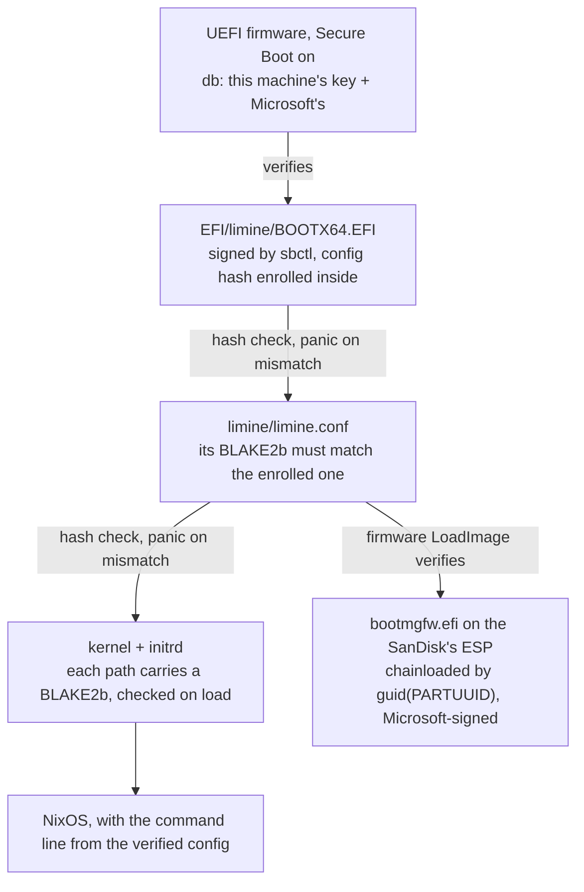

# boot and Secure Boot

Modules: [`modules/nixos/core/boot.nix`](../../../modules/nixos/core/boot.nix),
[`modules/nixos/core/limine.nix`](../../../modules/nixos/core/limine.nix),
[`modules/nixos/core/secureboot.nix`](../../../modules/nixos/core/secureboot.nix),
[`modules/nixos/core/boot-trust.nix`](../../../modules/nixos/core/boot-trust.nix)

Limine (UEFI), in dualboot with Windows 11, signed with our own keys through sbctl. The modules
share one decision, so they share a page. The look of the menu and the splash: [splash](splash.md).

What checks what, from power-on, read in the pinned nixpkgs (`limine-install.py`) and Limine 12.5.2,
and drilled again on 12.9.3:

## Why Limine

Each system has ITS OWN ESP, on a separate disk: NixOS on the Kingston (`nvme0n1p1`, `/boot`) and
Windows 11 on the SanDisk's ESP. The `sd*` LETTER SWAPS between boots, so identify that one by
model or PARTUUID, never by `sdX`.

The loader has to reach Windows on the other ESP AND verify what it boots. GRUB reached Windows but
verified nothing after itself: the initrd went unchecked
([decision 0007](../../decisions/0007-grub-over-lanzaboote.md), now superseded). lanzaboote verifies
everything through a signed UKI, but is systemd-boot only. Limine does both without shim:
[decision 0015](../../decisions/0015-limine-over-grub.md). It replaced GRUB on this machine on
02/11/2026, after the gated migration in [limine-migration](../../guides/limine-migration.md).

What it keeps: the sbctl keys (`autoGenerateKeys` and `autoEnrollKeys` stay off), ten generations,
the Windows entry. What it adds: the initrd and the command line are verified, and the editor is
forced off, so nobody types `init=/bin/sh` at the menu. What it still does not stop: root on this
machine, which holds the db key unencrypted (ADR 0006), can sign anything.

The GRUB years left findings worth keeping (what made GRUB boot under Secure Boot, the minegrub
theme's `--class` trap, os-prober finding a dead root): they are in this note as of `3147c47c`,
`git show 3147c47c:docs/notes/boot-and-storage/boot.md`.

## The version: layer 2

`boot.loader.limine.package = pkgs.unstable.limine`: the newest release, 12.9.3 on 02/11/2026,
against stable's 12.5.2, following the repo's three layers. The installer script stays stable's;
it drives Limine through the config file and `enroll-config`, which held across 12.x. A bump is a
bootloader change, so it goes through `nix build .#vm-limine` (all seven subtests, Secure Boot,
the tampered initrd and the Windows chainload included) before `nh os boot`.

## The menu

**The Secure Boot indicator is Limine's own.** With no custom branding, its top line reads
`Limine <version> (x86-64, UEFI, Secure Boot)`, and the suffix is appended only when the FIRMWARE
reports Secure Boot active (`common/menu.c`). That is why `limine.nix` sets no branding: a custom
string would hide the one runtime fact the menu can show honestly.

**Generations** sit under one group, the newest first; ten are kept (`maxGenerations`), the same
count `nh clean` keeps ([core](../repo/core.md)). Limine copies each generation's kernel and initrd
into `/boot/limine`, named by store hash, so generations that share them take the space once.

**Windows by PARTUUID, chainloaded.** `protocol: efi` with
`path: guid(8f36a7a5-a54c-4c78-9d3d-1202514df9be):/EFI/Microsoft/Boot/bootmgfw.efi`, the GPT
partition GUID of the SanDisk's ESP, set by the host as `my.boot.windows.efiPartUuid`.
`efi_boot_entry` was the other option: it sets BootNext and reboots, a POST more and a dependency
on the NVRAM entry. **The price, stated**: if Windows is reinstalled or moves disks, the PARTUUID
changes and the entry fails at boot. It is a one-line edit; read it with `lsblk -o NAME,PARTUUID`.

**The TPM.** Limine measures into PCRs 8 and 9 (`common/lib/tpm.h`). The keyring's seal uses PCR 7
only ([desktop](../desktop/desktop.md)), so it survived the switch from GRUB; if it ever does not,
the failure is soft (the keyring starts locked) and `keyring-tpm-seal` re-seals it.

## What boot-trust records

A read-only root oneshot writes `/run/boot-trust.json` at boot and again whenever `limine.conf`
changes, and the NixOS Center reads it ([nixos-center](../desktop/nixos-center.md#boot-22102026)):

| Field | Source | Values |
| --- | --- | --- |
| `secureBoot`, `setupMode` | the `SecureBoot` and `SetupMode` efivars | on/off, user/setup, or unknown |
| `loader.running` | the Boot Loader Interface's `LoaderInfo` (Limine sets it) | e.g. `Limine 12.9.3`, or unknown |
| `loader.signed` | `sbverify --cert /var/lib/sbctl/keys/db/db.pem` on the installed binary | valid, invalid, missing, unknown |
| `integrity` | the `b2sum` of `limine.conf` found inside `BOOTX64.EFI` | enrolled, mismatch, unknown |
| `thisBoot` | taken once at boot, kept by later runs | verified only when every row above holds |

It also covers a gap in the installer: `limine-install.py` runs `sbctl sign` without checking its
exit code, so an unsigned loader would only show up as a refused boot. `boot-trust` re-checks after
every install and raises `my.alert` when the loader fails `sbverify`. The path unit fires on
`limine.conf`, which the installer writes BEFORE it copies, enrolls and signs the binary, so a bad
reading is re-read for up to 30 s before it counts (a false alarm on 02/11/2026 taught that).

Drilled in `vm-limine` (OVMF, Secure Boot on throwaway keys) and proven on this machine on
02/11/2026: `LoaderInfo` read `Limine 12.5.2` and every field above held
([vm-boot](../repo/vm-boot.md#vm-limine-the-bootloader-drill)).

## Microsoft's certificates are mandatory

`enroll-keys -m`, always. Without it, wiping the factory keys takes down Windows (whose bootloader
is signed by MS) **and** the Arc B580's option ROM, which is too.

Checked on 02/08/2026 on this machine: BIOS 2803's `db` already carries BOTH generations of CA,
the 2011 ones (Windows Production PCA / Corporation UEFI CA) and the 2023 ones (Windows UEFI CA
2023, Microsoft UEFI CA 2023, Option ROM UEFI CA 2023), and sbctl 0.18 embeds all six. That
matters NOW and not in theory: the 2011 CA expired in june/2026 and new Windows updates come
signed by the 2023 one. Enrolling only 2011 would be a Windows that boots today and stops booting
on some Patch Tuesday. (`--firmware-builtin` is no good here: this firmware's `dbDefault` is
EMPTY.)

## The runbook

Enrolling a key requires the firmware in Setup Mode, and Setup Mode is only entered through the
BIOS. None of this is automatable; what Nix automates is the signing.

0. **ON WINDOWS FIRST**: `manage-bde -status`. If any volume says "Protection On", run
   `manage-bde -off C:` and WAIT for the decryption to finish. Touching Secure Boot changes PCR 7,
   and BitLocker answers that by asking for the recovery key at boot, which nobody saved, because
   the account is local.
1. `sudo sbctl create-keys` (creates `/var/lib/sbctl/keys`)
2. `rebuild` (Limine's installer signs its binary)
3. BIOS (DEL): Secure Boot -> Key Management -> **Clear Secure Boot Keys**. Save and exit (F10).
   That puts the firmware in Setup Mode; the boot goes on as usual.
4. `sudo sbctl enroll-keys -m` (with Microsoft's certificates). `sbctl status` should show
   Setup Mode: Disabled.
5. BIOS: **Secure Boot -> Enabled** (OS Type: Windows UEFI mode). Reboot.
6. Check: `sbctl status`, and `/run/boot-trust.json` reading `signed: valid`.

**If the machine does not boot**, turn Secure Boot off in the BIOS. There is no bricking possible:
the only thing the firmware refuses is the binary, and turning SB off gives it back. The recovery
stick is in [limine-migration](../../guides/limine-migration.md).

## `/var/lib/sbctl` is critical state

It is in the backup's identity set since 03/10/2026 ([restic](restic.md)), so a reinstall puts the
SAME keys back and only `enroll-keys` runs again on new firmware. Losing the folder with no
backup means the next switch does not sign Limine, which means the machine does not boot with SB
on. Recovery then: SB off in the BIOS, redo steps 1 to 5.

It is the FIRST item to declare when impermanence lands (see
[`../open-items.md`](../../open-items.md)), otherwise a reboot wipes the keys.

## The mainline kernel

`linuxPackages_latest` instead of the release default (6.18.x). The reason is the VIDEO
DRIVER: the Arc B580's `xe` lives in the kernel, so a new kernel means a new driver, and it is the
only driver lever that does NOT require crossing channels, since `linuxPackages_latest` comes from
26.05 itself. See [`gpu.md`](../hardware/gpu.md) for why the rest of the graphics stack stays on stable.

It is safe here because there are zero out-of-tree modules (no zfs or virtualbox to version match)
and Limine checks the kernel by the hash in its enrolled config, not by a signature, so changing
kernels never asks for a key re-enroll.

**PREFER `nixos-rebuild boot` plus a reboot** when changing kernel versions, but `switch` does NOT
break it: NixOS keeps `/run/booted-system/kernel-modules` with the tree of the RUNNING kernel, so
modprobe and udev keep resolving. Verified on 06/08/2026: a switch from 6.18.42 to 7.1.6 with zero
failing services. The advantage of `boot` is only not restarting a service inside a generation
whose kernel has not come up yet. Rollback is the previous generation in the Limine menu.

## `/tmp` is wiped at every boot

`/tmp` is a plain directory on the btrfs root, not a tmpfs, so before `boot.tmp.cleanOnBoot` it
survived every reboot. On 03/10/2026 that broke flameshot's clipboard in silence: a
KDSingleApplication lock (`/tmp/kdsingleapp-v1cferr-2-org.flameshot.Flameshot.lock`) left on
26/09 carried the OLD hostname `nixos-kingston`. `QLockFile` can only prove a lock stale by
checking its PID on the SAME host, so it assumed a live owner elsewhere, and every daemon exited
with status 0 and no log. On Wayland nothing then held the image, so the capture saved but never
reached the clipboard.

The symptom to recognize: a single-instance Qt app that "does nothing" and exits 0. `strace -e
trace=openat` shows the `EEXIST` on the lock. Not a tmpfs on purpose: a large build or download
in `/tmp` would otherwise eat RAM.

## NTFS support

The `ntfs3` driver already ships in the kernel, but what `mount` looks for is the userspace helper
`mount.ntfs-3g`, which only exists with `boot.supportedFilesystems`. Kept after the dualboot was
done so the Windows disk can be read on demand. There is no permanent mount of it.
