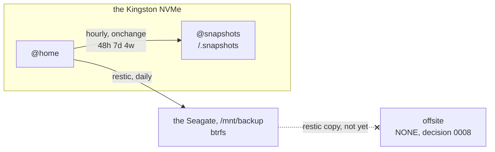

# btrbk: local snapshots of @home

`modules/nixos/services/btrbk.nix`. The minutes-scale "undo".

## It is NOT a backup

A snapshot lives on the SAME disk as the data. The Kingston dies, the snapshots die with it.
What covers that is [restic](restic.md), daily, onto the Seagate backup disk since 04/10/2026
([decision 0011](../../decisions/0011-local-disk-backup.md)). An offsite copy is still open
([decision 0008](../../decisions/0008-no-offsite-backup-yet.md)), so theft, fire or a surge that
takes both disks is the remaining accepted risk. The two tools answer different questions:

| | answers | cadence |
| --- | --- | --- |
| restic | "the NVMe died" | daily, other disk, encrypted |
| btrbk | "I overwrote the file 20 minutes ago" | hourly, instant, local |

restic alone leaves a hole of up to 24 h and a restore that takes minutes. btrbk closes that hole
for ~zero cost, because a CoW snapshot copies nothing: it only starts taking space to the EXTENT
that the original data diverges.

Where a copy of `@home` exists today, and where none does:

## @home only

The root is left out on purpose. On NixOS the system's rollback already IS the GRUB generation
list, and a snapshot of `/` would not even take `/nix` (a separate subvolume, since a snapshot
does not descend into a nested one). Noise with no gain.

## The prerequisite

The `@snapshots` subvolume mounted at `/.snapshots` (see [disko](disko.md)). On an already
installed system it is created by hand ONCE; the command is over there.

`RequiresMountsFor = "/.snapshots"` is the same lock restic used: without it mounted, btrbk would
write inside `@`, the one place where impermanence erases everything, and without the owner
noticing.

## The settings that are not obvious

- `snapshot_create = "onchange"`: nothing written since the last snapshot means no new one.
  Without it the machine on and idle would generate 24 identical snapshots a day and push the
  useful ones out of the retention window.
- `snapshot_preserve = "48h 7d 4w"`: about 2 days of fine granularity plus a month of safety net.
  It matched restic's `--keep-daily 7 --keep-weekly 4`, so btrbk covered exactly what was too
  short for the daily backup to reach; with restic retired, it is the only history there is.
  `snapshot_preserve_min = "latest"` guarantees it never ends up with NO snapshot at all.
- `timestamp_format = "long"` because an hourly snapshot needs hour:minute in the name.
- The ABSOLUTE PATH form, with no `volume` section. btrbk's other form (`volume <pool>` plus a
  relative subvolume) presumes `subvolid=5` mounted in a directory, and mounting the top
  permanently would make every subvolume appear TWICE in the tree, which confuses `du`, `find` and
  any sweep. With an absolute path btrbk resolves `/home` directly.
- `Persistent = true` on the timer already comes from the btrbk module. It matters on this machine
  because it reboots a lot, but there is no need to repeat it.

## Restoring

A file is a `cp` from `/.snapshots/home.<timestamp>/...`, since a snapshot is just a browsable
directory. Reverting the WHOLE @home is a manual, conscious operation (swapping the subvolume),
never automatic.
